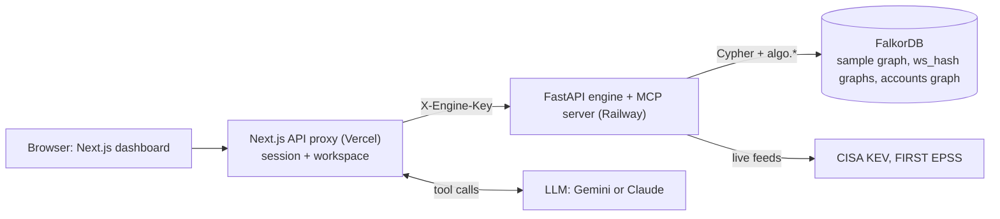

# BlastRadius

**See the attack paths. Fix what actually matters.**

**Live demo: [blastradius-ashy.vercel.app](https://blastradius-ashy.vercel.app)** · **Demo video: [watch on YouTube](https://youtu.be/IauSZKEO8PQ)** · **Blog: [read on DEV.to](https://dev.to/kaustubh_negi/-blastradius-why-severity-scores-lie-and-how-graph-ai-solves-real-attack-paths-4846)**

BlastRadius maps infrastructure as a graph in FalkorDB, finds every real route from the internet to your crown jewels, ranks findings by the attack paths they sit on (not CVSS), and fixes the few that cut them: automatically when low-risk, with human approval when not. An AI advisor reads the graph through MCP tools.


## What's new here

Most vulnerability tools sort findings by a severity score and stop there. BlastRadius is built around a different question: *which fixes cut real routes to the things an attacker is after, and which of those is it safe to apply automatically?*

- **The graph decides what the agent may do, not the model.** Every finding gets an autonomy tier (`auto`, `approval`, `monitor`) computed from graph facts: a leaf host on a single path is safe, a choke point or a neighbour of the crown jewel is not. `apply_safe_fix` enforces it, so the agent refuses risky fixes even if it is asked to apply them.
- **FalkorDB's own algorithms are agent tools.** `algo.betweenness`, `algo.pageRank` and `algo.SPpaths` are exposed over MCP, so the agent ranks exposure and finds attack routes with the database, not with prompt guesses.
- **Answers you can see.** When the agent cites a route, the dashboard draws it on the graph. The route disappears as soon as a fix cuts it, because it is checked against the live attack paths.
- **Simulate before acting.** The same path query is re-run with one finding treated as patched, so every fix comes with "paths before and after".
- **One private graph per user, with per-user memory.** Imported inventories (JSON or Trivy reports) become their own FalkorDB graph, and the agent's decisions, including refusals, are stored as nodes in that workspace and recalled in later sessions.
- **Real public risk data.** CISA KEV and FIRST EPSS are fetched live, so "is it exploited?" comes from current feeds, with the data source stated in every answer.
- **From finding to workflow.** The agent drafts a ready-to-file Jira or GitHub ticket with the graph evidence, impact and rollback note, and can file a real GitHub issue when the deployment opts in.

## Try it in 60 seconds

1. Open the **[live demo](https://blastradius-ashy.vercel.app)** and sign in with Google.
2. Dashboard → **Run scan**: 4 attack paths from the internet to the customer database.
3. Open **Ask advisor** and type, in order:
   - `Where is the choke point?`: FalkorDB algorithms (`algo.betweenness`, `algo.pageRank`) through an MCP tool
   - `Show the shortest route an attacker could take`: the route is drawn on the graph (`algo.SPpaths`)
   - `Fix everything that is safe`: it simulates, applies the low-risk fixes, and **refuses** the choke point (the graph decides, not the model)
   - `Draft a Jira ticket for the top finding`, then `What did you do earlier?` (per-tenant memory stored in FalkorDB)
4. **Use your own data** (sidebar) → *Load example* → *Import and scan*: your inventory becomes a private FalkorDB graph.
5. **Restore demo for everyone** resets the shared sample.

## How it fits together



**Submission checklist (hackathon Rule 10):** public repo ✅ · README with setup and graph data model ✅ (below) · the Cypher queries and algorithms the product depends on ✅ (below) · live deployment ✅ (link above) · demo video ✅ ([YouTube](https://youtu.be/IauSZKEO8PQ)) · track: **Agents That Act on Connected Data** · AI assistance is disclosed under "AI disclosure" below.

## Graph Hacks (WeMakeDevs x FalkorDB) · Track 1: Agents That Act on Connected Data

**The agent:** the BlastRadius advisor triages security findings and *acts*. It finds where one fix cuts the most routes to a crown jewel, simulates the fix, applies it if the graph says it is low-risk, escalates everything else to a human, and remembers what it did. Every step is a visible MCP tool call.

| Track 1 focus | How BlastRadius does it |
|---|---|
| Multi-hop reasoning | Bounded variable-length Cypher: `(:Internet)-[:CAN_REACH*1..6]->(:DataStore {crown:true})` through still-exploitable hosts |
| Graph algorithms as agent tools | `get_choke_points` = FalkorDB `algo.betweenness` + `algo.pageRank`; `explain_attack_path` = FalkorDB `algo.SPpaths` |
| Tool selection through MCP | A real MCP server (`backend/mcp_server.py`) and client (`frontend/lib/advisor/mcp.ts`); Gemini or Claude pick the tools |
| Actions based on what the graph shows | `apply_safe_fix` patches only findings whose **graph-computed tier** is `auto` (leaf host, one path). Choke points and crown-jewel neighbours are refused and handed to a human. The model cannot override the tier |
| Explainable results | Each answer cites the exact routes, path counts before/after (`simulate_fix`), and the tier reason. When the agent cites a route, the dashboard **draws it on the graph** (blue edges, ringed hosts) |
| Real public data | CISA KEV and FIRST EPSS are fetched live (`backend/enrich.py`, cached 24h, background refresh, snapshot fallback). The data notice in every answer says which one is in use |
| Acts in the real workflow | `draft_fix_ticket` writes a ready-to-file GitHub or Jira ticket from graph evidence (paths, KEV, EPSS, simulated impact, rollback). `file_github_issue` files it as a real GitHub issue when the deployment opts in (`GITHUB_TOKEN`, `GITHUB_REPO`), capped at 5/hour, only when the user asks |
| Your own data | "Use your own data" in the dashboard imports an inventory (hosts, data stores, reachability, findings, optional Trivy JSON) into a **private FalkorDB graph per user** (`ws_<hash>`). Every query and agent tool then runs on it unchanged; the shared sample is untouched. `POST /api/import`, validated and size-capped (`backend/ingest.py`) |
| Memory (bonus) | Per tenant: every decision, including refusals, is stored as `(:Agent)-[:DID]->(:AgentAction)-[:IN]->(:Workspace)` and recalled with `recall_agent_memory`, scoped to the workspace it was taken in. It survives chats and "restore demo" |

### Graph data model
```
(:Internet)-[:CAN_REACH]->(:Host)-[:CAN_REACH]->(:DataStore {crown})
(:Host)-[:HAS_FINDING]->(:Finding {cve, cvss, epss, kev, exploitable, patched})
(:Fix {mode, ts, rollback})-[:FIXES]->(:Finding)
(:Agent {name})-[:DID]->(:AgentAction {tool, finding_id, host, decision, rationale, paths_before, paths_after})   -- accounts graph
(:User {id, plan})                                                                                           -- accounts graph
-- one graph per workspace: the shared sample, or ws_<hash(user id)> for imported inventories (same schema)
```

### The Cypher and algorithms the product depends on
```cypher
// attack paths (backend/engine.py)
MATCH p = (:Internet)-[:CAN_REACH*1..6]->(d:DataStore {crown: true})
WHERE all(n IN nodes(p) WHERE n:Internet OR n:DataStore OR size(n.xf) > 0)
RETURN [n IN nodes(p) | n.id]

// what-if: same query with a finding treated as patched (backend/threat_tools.py, SIM_PATHS)
// choke points: FalkorDB betweenness centrality
CALL algo.betweenness({nodeLabels: ['Internet','Host','DataStore'], relationshipTypes: ['CAN_REACH']}) YIELD node, score
// shortest routes to the crown jewel
MATCH (s:Internet), (t:DataStore {crown: true})
CALL algo.SPpaths({sourceNode: s, targetNode: t, relationshipTypes: ['CAN_REACH'], pathCount: $n}) YIELD path
```

### Run it
See "Run locally" below. Data: synthetic topology with real CVE ids; KEV and EPSS are live public feeds; CVSS is a snapshot. Tests (66): backend 33 (`cd backend && pip install -r requirements.txt pytest && pytest`) and frontend 33 (`cd frontend && npm test`). Backend unit tests cover the safety tiers, import validation and edge de-duplication, and the live-feed client with the network mocked; integration tests (run in CI against a real FalkorDB service) cover the agent's tools and refusals, the pitch story (4 paths to 0), per-user graphs and per-tenant memory. Frontend tests cover the engine client and its error mapping, signed checkout tokens, subscription handling and the advisor providers. Demo script: [docs/DEMO_SCRIPT.md](docs/DEMO_SCRIPT.md). Blog post: [docs/BLOG.md](docs/BLOG.md).

## The four parts (work on one without touching the others)

| Folder | What it is | Stack | Deploys to | Own docs |
|---|---|---|---|---|
| [`frontend/`](frontend) | Web app: landing, Google sign-in, dashboard, billing, advisor UI | Next.js 16, React 19, Tailwind | **Vercel** (Root Directory = `frontend`) | [frontend/README](frontend/README.md) |
| [`backend/`](backend) | API + MCP server: scan, fixes, tiers, tools | FastAPI, MCP | **Railway** (Docker) | [backend/README](backend/README.md) |
| [`database/`](database) | Graph layer: FalkorDB connection, schema/seed, account store | Python package + FalkorDB | **Railway** (`falkordb` image) | [database/README](database/README.md) |
| [`keys/`](keys) | Every environment variable: templates, who needs what, setup/check scripts | shell | n/a (real values live in Vercel/Railway, never in git) | [keys/README](keys/README.md) |

```
 browser ──▶ frontend (Vercel) ──HTTP /api/* + MCP, X-Engine-Key──▶ backend (Railway) ──blastradius_db──▶ FalkorDB (Railway, private)
                 │  Google sign-in, Gemini/Claude advisor                                                       
                 └──── keys/ documents every secret and where it is set
```

### Boundaries (what makes the parts independent)
- **frontend ↔ backend:** only HTTP (`/api/*`) and MCP (`/mcp/`), authenticated by the `X-Engine-Key` header. The frontend never imports backend code.
- **backend ↔ database:** only the `blastradius_db` Python package (`database/`). The database package never imports the backend.
- **secrets:** only in environment variables. Templates are in `keys/`; real values never enter git (`keys/check.sh` verifies this).
- **CI:** `.github/workflows/` runs `frontend`, `backend` and `database` checks **only when that folder changes**.

## Run locally
```bash
keys/setup.sh                       # creates frontend/.env.local and backend/.env, generates matching secrets
# fill GOOGLE_CLIENT_ID / GOOGLE_CLIENT_SECRET / GEMINI_API_KEY in frontend/.env.local, then:
keys/check.sh                       # confirms keys are set, match, and nothing secret is tracked

docker compose -f database/docker-compose.yml up -d                       # 1) FalkorDB on :6379
cd backend && python3.12 -m venv .venv && .venv/bin/pip install -r requirements.txt \
  && .venv/bin/uvicorn main:app --port 8000                               # 2) API + MCP on :8000
cd frontend && npm install && npm run dev                                  # 3) web app on :3000
```

## Deploy (one-time platform settings)
- **Vercel:** Project → Settings → General → **Root Directory = `frontend`**. Env vars: see `keys/frontend.env.example`.
- **Railway, backend service:** Settings → Source → **clear the Root Directory** (repo root) and set the **config file path** to `backend/railway.json`. Env vars: `keys/backend.env.example`.
- **Railway, database service:** Docker image `falkordb/falkordb:latest`, a volume at `/var/lib/falkordb/data`, no public domain. Env vars: `keys/database.env.example`.

## AI Disclosure
Developed with AI coding assistance (Claude Code) for boilerplate and testing. All graph data modeling, Cypher queries, MCP tool implementations, and autonomy tier architecture were designed, reviewed, and verified by the team.

## License
MIT. See [LICENSE](LICENSE).
